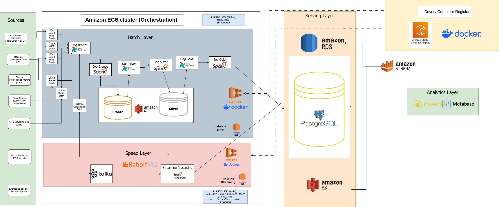

# Architecture Overview

## 1. Overview

MercaAndes Omnicanal is designed as a data platform that integrates and processes information from multiple sources to support sales, inventory, and marketplace analytics across different countries.

The target architecture combines the **Lambda Architecture** and the **Medallion Architecture**. This approach separates historical batch processing from near-real-time stream processing while organizing data according to its level of transformation and quality.

The infrastructure design uses AWS services and containerized workloads to support data ingestion, processing, orchestration, storage, and analytics.

> **Architecture status:** This document describes the target architecture approved for the project. The implementation and deployment status of individual components may vary.

## 2. Architecture Diagram

The following diagram presents the high-level target architecture, including data sources, processing layers, storage, and analytical consumption.

The architecture separates processing responsibilities while connecting data ingestion, transformation, storage, and analytics.

## 3. Architectural Patterns

### 3.1. Lambda Architecture

The Lambda approach divides data processing into two logical layers.

**Batch Layer**

Processes historical data through scheduled workflows. Apache Airflow orchestrates the workflows, while Apache Spark performs data transformations and batch processing.

**Speed Layer**

Processes incoming events to support near-real-time operational visibility. Apache Kafka provides event streaming, RabbitMQ handles operational messaging, and Spark Streaming processes event streams.

### 3.2. Medallion Architecture

The Medallion pattern organizes data into three levels of maturity within the Amazon S3 data lake.

| Layer  | Purpose                                                                 |
| ------ | ----------------------------------------------------------------------- |
| Bronze | Stores raw data received from source systems.                           |
| Silver | Stores cleaned, validated, standardized, and deduplicated data.         |
| Gold   | Stores enriched, modeled, and aggregated data for business consumption. |

These layers support data quality, traceability, and the progressive transformation of source data into business-ready information.

## 4. Main Architecture Layers

### 4.1. Data Sources and Ingestion

The platform receives data from historical datasets, external APIs, and simulated commercial sources.

The project includes POS sales simulation, inventory-related functionality, marketplace events, and supporting datasets such as exchange rates, public holidays, and promotions.

Ingestion processes collect and load the information required by the platform.

### 4.2. Processing and Orchestration

The target processing architecture uses:

- **Apache Airflow** to define, schedule, and monitor data workflows.
- **Apache Spark** to execute batch transformations.
- **Apache Kafka** to transport streaming events.
- **RabbitMQ** to manage asynchronous operational messages.
- **Spark Streaming** to process incoming events in micro-batches.

### 4.3. Storage and Serving

**Amazon S3** provides the data lake for the Bronze, Silver, and Gold layers.

**Amazon RDS for PostgreSQL** provides relational storage for structured data intended for serving and operational consumption.

**Amazon Athena** enables SQL queries over datasets stored in Amazon S3.

### 4.4. Analytics and Consumption

The target analytics layer includes:

- **Power BI** for business intelligence dashboards and executive reporting.
- **Metabase** for data exploration and ad hoc queries.

These tools provide access to analytical information through the appropriate serving and data lake sources.

## 5. Infrastructure and Security

The infrastructure design uses AWS services to isolate workloads and control access.

- **Amazon VPC:** provides an isolated network environment.
- **Public and private subnets:** separate internet-facing resources from internal compute and data services.
- **AWS IAM:** manages permissions according to the principle of least privilege.
- **Security Groups:** control network communication between services.
- **Amazon ECR:** stores private container images.
- **Amazon ECS:** orchestrates containerized workloads.
- **Amazon EC2 and AWS Fargate:** provide compute capacity for designated workloads.

The target design places internal processing services and the database in private network segments, with controlled access between components.

## 6. High-Level Data Flow

The target architecture follows this general flow:

1. Data is generated by simulators or obtained from external sources.
2. Ingestion processes collect and validate incoming information.
3. Batch and streaming components process data according to their respective workflows.
4. Amazon S3 stores datasets across the Bronze, Silver, and Gold layers.
5. Amazon RDS for PostgreSQL and Amazon Athena provide access to structured and data lake datasets.
6. Power BI and Metabase consume the data for analytics and reporting.

The exact execution sequence and integration mechanisms depend on the implementation of each pipeline.

## 7. Implementation Status

The architecture describes the intended design of the platform. Not all components should be assumed to be deployed or fully integrated.

Existing project materials describe functionality related to sales simulation, shared catalog data, supporting-data ingestion, and exploratory analysis.

The complete streaming architecture, general-purpose Silver and Gold transformations, and some end-to-end integrations remain subject to implementation and verification.

The implementation status should be updated as components are completed and tested.

## 8. Related Documentation

- [Architecture Components](docs/02-architecture/02-components.md)
- [Architecture Decisions](docs/02-architecture/04-technical-decisions.md)

For environment configuration and execution instructions, refer to the Installation and Deployment section.
