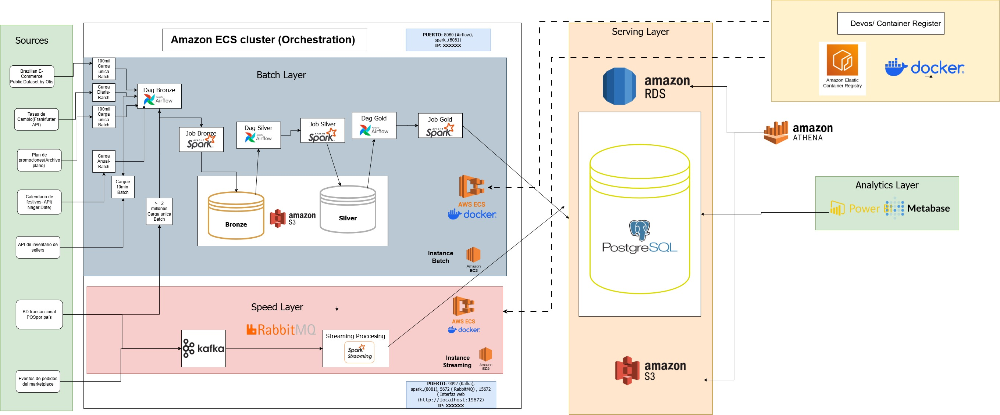

# Architecture Overview

## 1. Overview

MercaAndes Omnicanal is a data platform that integrates and processes information from multiple sources to support sales, inventory, and marketplace analytics across the five operating countries.

The architecture combines the **Lambda Architecture** and the **Medallion Architecture**. This approach separates historical batch processing from near-real-time stream processing while organizing data according to its level of transformation and quality.

The infrastructure uses AWS services and containerized workloads to support data ingestion, processing, orchestration, storage, and analytics in the `us-east-1` region.

## 2. Architecture Diagram

The following diagram presents the high-level architecture, including data sources, processing layers, storage, and analytical consumption.

The architecture separates processing responsibilities while connecting data ingestion, transformation, storage, and analytics.

## 3. Architectural Patterns

### 3.1. Lambda Architecture

The Lambda approach divides data processing into two logical layers.

**Batch Layer**

Processes historical data through scheduled workflows. Apache Airflow orchestrates the workflows (historical load, cleaning, business rules, seller scoring, and weekly promotions), while Apache Spark performs the batch transformations through JDBC and S3.

**Speed Layer**

Processes incoming events to support near-real-time operational visibility. Apache Kafka transports the marketplace order events (topic `mercaandes.orders.events`), RabbitMQ handles operational messaging and notifications, and Spark Streaming processes the order stream in micro-batches into the `hot_inventory_risk` table.

### 3.2. Medallion Architecture

The Medallion pattern organizes data into three levels of maturity within the Amazon S3 data lake.

| Layer  | Purpose                                                                 |
| ------ | ----------------------------------------------------------------------- |
| Bronze | Stores raw data received from source systems (Olist dataset, promotions files, raw marketplace events). |
| Silver | Stores cleaned, validated, standardized, and deduplicated data.          |
| Gold   | Stores enriched, modeled, and aggregated data for business consumption.  |

The serving layer reproduces the same separation in PostgreSQL: the `silver` schema holds curated and anonymized views, and the `gold` schema holds the official Power BI views. The processing DAGs also work with the staging schemas `z1_silver` and `z2_gold` during their runs.

## 4. Main Architecture Layers

### 4.1. Data Sources and Ingestion

The platform receives data from historical datasets, external APIs, and simulated commercial sources.

- POS sales are seeded into the PostgreSQL serving layer and streamed into the country topic pipelines.
- The Olist historical dataset is loaded once (`f1_kaggle_historical` DAG).
- Exchange rates come from the Frankfurter API and holidays from the Nager.Date API.
- Marketplace events are generated through the Marketplace API and published to Kafka.
- Promotions arrive as weekly Excel files processed by the F7 service.

### 4.2. Processing and Orchestration

- **Apache Airflow 3.1.5** defines, schedules, and monitors six DAGs (including a partitioned reprocessing DAG).
- **Apache Spark 3.5** executes batch transformations (seller score, business rules) both in its cluster and through Airflow JDBC tasks.
- **Apache Kafka** transports streaming orders with 3 partitions and 7-day retention.
- **RabbitMQ** manages notifications, weekly promotion ingestion, alerts, and asynchronous reports.
- **Spark Streaming** detects imminent stockouts in micro-batches.

### 4.3. Storage and Serving

**Amazon S3** provides the data lake for the Bronze, Silver, and Gold layers (bucket `mercaandes-data-lake-<account>`).

**Amazon RDS for PostgreSQL 16** provides the relational serving layer: transactional POS data per country, shared dimensions and facts, and the Silver/Gold analytical views for the business dashboard.

**Amazon Athena** enables SQL queries over the datasets cataloged in the AWS Glue Data Catalog and stored in S3.

### 4.4. Analytics and Consumption

- **Power BI** consumes the `gold` views of the serving layer as the official source for the commercial dashboard.
- **Metabase** is used for data exploration and ad hoc queries.

## 5. Infrastructure and Security

The infrastructure runs on AWS in `us-east-1`:

- **Amazon VPC:** public and private subnets across Availability Zones.
- **Security Groups:** `mercaandes-sg-rds` (5432), `mercaandes-sg-alb-apis` (80, 8000), and the batch and streaming node groups.
- **AWS IAM** roles: API EC2 role, batch node, streaming node, CI/CD pipeline, and the ECS task execution role.
- **Amazon ECR:** private registry for the container images (14 repositories listed in the [image catalog](aws-infrastructure.md#amazon-ecr)).
- **Amazon ECS with Fargate:** runs the Inventory, Marketplace, and Promotions APIs (cluster `mercaandes-ecs-cluster`).
- **Amazon EC2:** hosts the batch node (Airflow + Spark) and the streaming node (Kafka + RabbitMQ).
- **Amazon RDS for PostgreSQL:** the Gold serving database (`mercaandes-postgres-gold`).

Details and cost drivers are described in [AWS Infrastructure and Costs](aws-infrastructure.md).

## 6. High-Level Data Flow

The platform follows this general flow:

1. Data is generated by simulators or obtained from external sources.
2. Ingestion processes seed the serving database, load the S3 Bronze layer, and publish events to Kafka and RabbitMQ.
3. Batch workflows (Airflow + Spark) process data through the Silver and Gold business rules; streaming consumers maintain the hot stock tables.
4. Amazon S3 stores datasets across the Bronze, Silver, and Gold layers, partitioned for Athena queries.
5. Amazon RDS for PostgreSQL serves the operational and analytical views.
6. Power BI and Metabase consume the Gold views for analytics and reporting.

## 7. Related Documentation

- [Architecture Components](02-components.md)
- [AWS Infrastructure and Costs](aws-infrastructure.md)
- [Architecture Decisions](04-technical-decisions.md)

For environment configuration and execution instructions, refer to the Installation and Deployment section.
