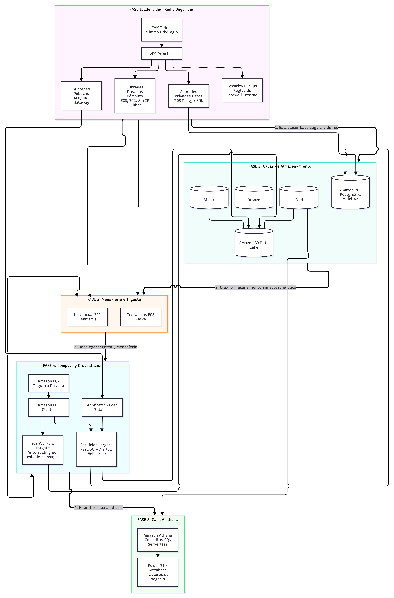

# Infrastructure and Deployment Architecture

## 1. Overview

The MercaAndes infrastructure design uses AWS services to support containerized applications, data processing, storage, messaging, and analytical workloads.

The deployment plan is organized into five phases, beginning with network security and ending with the analytics layer.

> **Status:** The phases described below represent the documented deployment plan. Their inclusion does not confirm that all resources have already been provisioned.

## 2. Infrastructure Diagram

The following diagram presents the planned infrastructure and its deployment phases.

## 3. Network and Security Foundation

The first phase establishes the network and access-control foundation.

### Amazon VPC

A custom VPC provides an isolated network environment for the platform.

The plan calls for public and private subnets distributed across at least two Availability Zones.

- **Public subnets:** intended for internet-facing resources, such as the Application Load Balancer.
- **Private compute subnets:** intended for internal processing workloads.
- **Private data subnets:** intended for the PostgreSQL database.

An Internet Gateway provides internet connectivity for public resources. A NAT Gateway allows private resources to access external services when required.

### AWS IAM

IAM roles provide permissions to AWS services and workloads.

The plan identifies an ECS Task Execution Role for pulling images from ECR and sending logs, along with workload-specific permissions for accessing S3 and RDS.

### Security Groups

The documented security design includes:

- **SG_ALB:** controls incoming HTTP and HTTPS traffic to the load balancer.
- **SG_ECS:** restricts application traffic to approved sources, including the load balancer where applicable.
- **SG_RDS:** allows PostgreSQL traffic on port 5432 only from authorized application resources.

The database and internal processing services are intended to remain inaccessible directly from the public internet.

## 4. Storage Layer

### Amazon S3

Amazon S3 provides storage for the data lake.

The plan organizes data into Bronze, Silver, and Gold layers, either through separate buckets or prefixes within a main bucket.

### Amazon RDS for PostgreSQL

Amazon RDS hosts the relational serving database in private data subnets.

The deployment plan includes configuring the appropriate Security Group and validating connectivity from an authorized client.

## 5. Messaging and Ingestion

### RabbitMQ and Kafka

The deployment plan proposes running RabbitMQ and Kafka on EC2 instances in private compute subnets.

These services support asynchronous messaging and event streaming.

The configuration includes the required messaging resources, connectivity, and acknowledgement mechanisms.

## 6. Compute and Orchestration

### Amazon ECR

Private ECR repositories store container images for APIs, workers, and processing jobs.

Images are built, versioned, and pushed to the registry before deployment.

### Amazon ECS and Application Load Balancer

Amazon ECS manages the deployment of containerized services using task definitions and the corresponding container images.

An Application Load Balancer distributes incoming application traffic to supported services and uses health checks to identify healthy targets.

The plan includes Fargate services behind the load balancer.

### Asynchronous Workers

Worker services consume messages from RabbitMQ and execute background tasks.

The target design includes scaling workers according to workload demand. Queue-depth-based scaling requires an appropriate metric and scaling configuration.

## 7. Analytics Layer

### Amazon Athena

Amazon Athena queries datasets stored in Amazon S3 through SQL.

The deployment plan includes creating external tables that reference the appropriate data lake locations.

### Power BI and Metabase

Power BI and Metabase provide analytical consumption and business reporting.

Their connections depend on the availability and configuration of the corresponding data sources.

## 8. Deployment Phases

| Phase                              | Objective                                                                          |
| ---------------------------------- | ---------------------------------------------------------------------------------- |
| 1. Network and Security Foundation | Configure IAM, VPC, subnets, routing, and Security Groups.                         |
| 2. Storage Layers                  | Prepare S3 data lake storage and the RDS PostgreSQL instance.                      |
| 3. Messaging and Ingestion         | Deploy and validate RabbitMQ and Kafka.                                            |
| 4. Compute and Orchestration       | Publish container images, configure ECS and the load balancer, and deploy workers. |
| 5. Analytics Layer                 | Configure Athena tables and validate analytical access.                            |

Each phase should be validated before the next dependent components are integrated.

## 9. Validation and Security Considerations

The deployment plan identifies several validation activities:

- Verify IAM roles and least-privilege permissions.
- Confirm that private resources are not publicly accessible.
- Test authorized PostgreSQL connectivity.
- Validate RabbitMQ connectivity within the VPC.
- Confirm that container images are available in ECR.
- Verify ECS service health and worker message consumption.
- Execute a sample Athena query against the data lake.

Credentials and secrets must be stored securely and must not be committed to source control.

## 10. Related Documentation

- [Architecture Overview](docs/03-architecture/01-overview.md)
- [Architecture Components](docs/03-architecture/02-components.md)
- [Technical Decisions](docs/03-architecture/04-technical-decisions.md)
