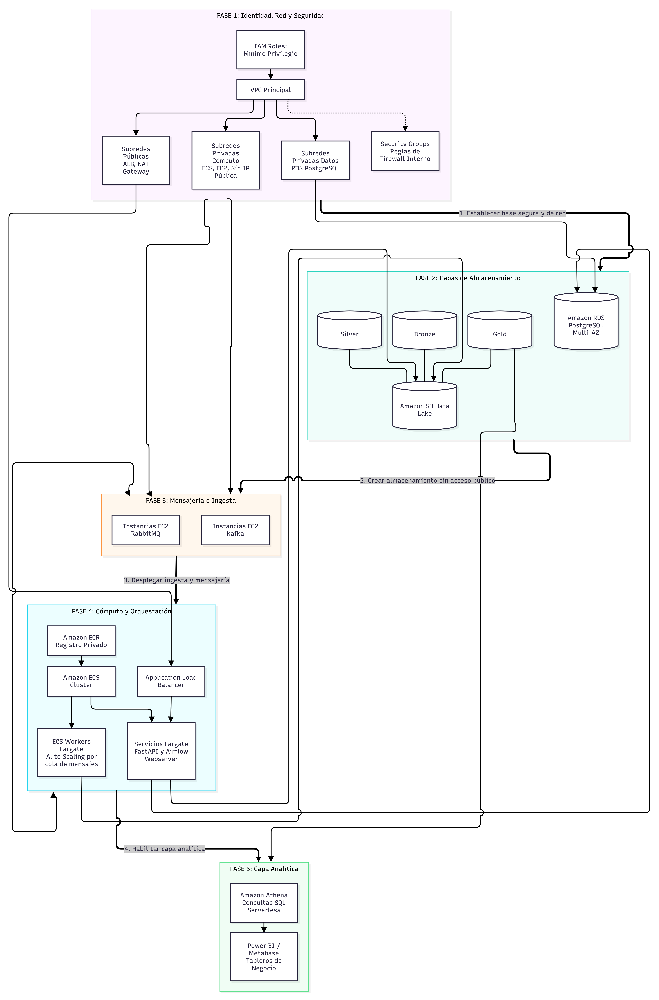

# Infrastructure and Deployment Architecture

> **Proposal status:** Accepted
> **Date:** October 9, 2026
> **Project:** MercaAndes

## Purpose and scope

This page describes the accepted AWS infrastructure architecture for MercaAndes and how its five phases fit together, from network and identity through analytical consumption. It covers the project's APIs, ingestion and messaging workloads, data lake, relational serving database, and analytics tools.

## Infrastructure diagram

The diagram summarizes the five accepted phases and the main dependencies between them.

The sequence shows the dependencies between platform layers, from foundational network and identity services to analytics.

## Phase 1: Network and security foundation

### Identity and permissions

Use separate IAM roles for AWS service execution and application workloads. The **ECS task execution role** grants ECS the permissions needed to pull images from ECR and publish container logs to CloudWatch. Application task roles receive only the AWS permissions required by that workload, such as access to specific S3 prefixes.

Database access is controlled through private network placement, Security Groups, database credentials, and the database's own authorization. An IAM role alone does not grant a container access to PostgreSQL. Store credentials in an approved secret store and grant workloads access only to the required secret.

Review each role's trust policy and permissions for least privilege. Avoid broad permissions such as unrestricted `s3:*` or database access to every resource when a narrower policy will work.

### VPC and subnets

Place the platform in a custom VPC. Distribute public and private subnets across at least two Availability Zones where the selected service and cost model require it.

- **Public subnets** host internet-facing entry points such as the Application Load Balancer. An Internet Gateway provides their internet route.
- **Private compute subnets** host internal services and workers, including ECS tasks and private EC2 workloads for messaging where applicable.
- **Private data subnets** host Amazon RDS for PostgreSQL.
- A **NAT Gateway** can provide outbound internet access for private workloads that need external APIs or updates. Its hourly and data-processing charges should be included in the cost estimate.

Keep databases and internal brokers off public subnets. Give private workloads only the routes and outbound access they need.

### Security Groups

Treat Security Groups as stateful, resource-level firewalls. The intended traffic boundaries are:

| Group | Intended inbound traffic |
|---|---|
| `SG_ALB` | HTTP/HTTPS from approved internet clients; prefer HTTPS for public access. |
| `SG_ECS` | Application traffic from `SG_ALB` only for services exposed through the load balancer. Add narrowly scoped rules for internal service-to-service communication. |
| `SG_RDS` | PostgreSQL on port 5432 only from the specific application or worker Security Groups that require database access. |

Do not open port 5432 to `0.0.0.0/0`. Verify that RDS is not publicly accessible and that an internet client cannot connect directly to the database. For an authorized connectivity check, use a workload or controlled test host inside the VPC with a narrowly scoped rule, then remove temporary access.

## Phase 2: Storage layers

### Amazon S3 data lake

Store lake data in Bronze, Silver, and Gold layers. These can be separate buckets or prefixes in a bucket, provided access policies preserve the required separation. Block public access, enable encryption, and scope IAM permissions to the prefixes each workload needs.

Validate the write path with a harmless test object in the Bronze location, confirm that the intended role can read or write it, and remove the test object after the check. A successful upload confirms access to that path; it does not validate the ingestion or transformation pipeline.

### Amazon RDS for PostgreSQL

Place RDS PostgreSQL in the private data subnets and associate `SG_RDS`. Document the engine version, instance class, storage, backup retention, encryption, maintenance window, and whether Multi-AZ is enabled. These settings affect both resilience and cost.

The accepted diagram depicts PostgreSQL as Multi-AZ. Confirm that this matches the deployed RDS configuration and record its availability and cost trade-off; the diagram alone is not evidence that Multi-AZ is enabled.

Validate connectivity from an authorized application or test workload inside the VPC using a secret-managed credential and TLS where configured. Do not make RDS public or open port 5432 to test it from a personal computer. Confirm that backups and restoration procedures meet the project's recovery needs.

### Administrative access through an SSH tunnel

For an authorized administrator connecting from a workstation, the supplied connection profile describes a path through an EC2 bastion and an SSH tunnel to the private RDS endpoint. It identifies AWS region `us-east-2`, PostgreSQL port `5432`, and database `merca_gold`. Keep the exact RDS hostname, bastion address, account names, and credentials in an access-controlled operational store; this documentation site may be publicly accessible.

In the database client's SSH settings, use the bastion as the tunnel host and the RDS endpoint as the database host. The RDS Security Group must allow port 5432 from the bastion's Security Group. The bastion Security Group should allow port 22 only from approved administrator sources. Do not open either port to all internet addresses.

The profile's region and instance name need reconciliation before they are treated as the current production connection: the profile points to `us-east-2`, while the repository's Terraform default is `us-east-1`, and the Terraform RDS identifier differs from the supplied endpoint name. The database name and account name match the Terraform defaults, but confirm all values against the live RDS instance and the approved secret store.

For Amazon Linux 2 and Amazon Linux 2023, SSH password authentication is disabled by default; `ec2-user` normally connects with the EC2 key pair or an approved key-based access method. Do not assume that a password in a database client's SSH form is valid. Verify the bastion's AMI and authentication policy with its administrator. Use a separate database credential and SSH key, and rotate any credential that has been shared in chat or source control.

## Phase 3: Messaging and ingestion

RabbitMQ and Kafka support different messaging needs: RabbitMQ handles operational queues and asynchronous work, while Kafka provides a durable event stream for marketplace events and downstream consumers. The accepted design places broker workloads on EC2 instances in private compute subnets.

Define persistence, acknowledgements, retry and dead-letter behavior, Kafka topics and retention, and monitoring before relying on either broker for production events. Stateful brokers need a cluster and storage design that preserves broker identity and data. Do not add generic Auto Scaling to broker instances unless the cluster membership, persistent storage, and recovery behavior are designed for it.

Validate broker connectivity from another authorized workload in the same VPC. For RabbitMQ, check that the application can connect to the configured port (commonly 5672) without exposing the broker to the public internet. Then publish and consume a test message and confirm acknowledgement and recovery behavior.

## Phase 4: Container compute and orchestration

### ECR image registry

Publish private, versioned container images to Amazon ECR for APIs, workers, and processing jobs. Tag production images with an immutable commit or release identifier; `latest` can be retained for convenience, but should not be the only deployment reference.

Verify the expected image repository and tag or digest in ECR before updating an ECS task definition.

### ECS, Fargate, and Application Load Balancer

Amazon ECS manages service task definitions and deployments. Run supported API services on Fargate and place the Application Load Balancer in public subnets. Configure target groups and health checks so that the load balancer sends traffic only to healthy tasks. Restrict task ingress to the ALB Security Group for services that are meant to be accessed through it.

### Asynchronous workers and scaling

Run workers as ECS services or tasks in private compute subnets. Give each worker only the broker, database, secret, and S3 access that its job requires. Test message publication, consumption, acknowledgement, and CloudWatch logging.

Scaling workers based on queue depth requires a queue-depth metric to be made available to CloudWatch and connected to an ECS scaling policy. Treat this as implemented only after the metric, policy, and scale-out/scale-in behavior have been verified.

## Phase 5: Analytics layer

Register Gold datasets in the AWS Glue Data Catalog and query them with Amazon Athena. Configure Athena's query results location and its access permissions separately from the source data location. Use a small read-only query, such as a limited sample from a Gold table, to validate the catalog, S3 permissions, and query path.

Power BI or Metabase can consume curated data through the approved serving connection. Document the connection method and credentials separately; do not embed secrets in dashboards, source files, or this page.

## Phase summary

| Phase | Main outcome |
|---|---|
| 1. Network and security | IAM roles, VPC, subnet routes, and Security Groups establish controlled access. |
| 2. Storage | S3 layers and private PostgreSQL provide storage for authorized workloads. |
| 3. Messaging and ingestion | RabbitMQ and Kafka provide operational messaging and event streaming. |
| 4. Compute and orchestration | ECR, ECS/Fargate, workers, and the ALB run and route containerized services. |
| 5. Analytics | Athena queries cataloged Gold data for analytical consumers. |

## Related documentation

- [Architecture overview](01-overview.md)
- [Architecture components](02-components.md)
- [Technical decisions](04-technical-decisions.md)
- [IAM and security](05-iam-security.md)
- [Deployed APIs and operational consoles](06-services-apis.md)
