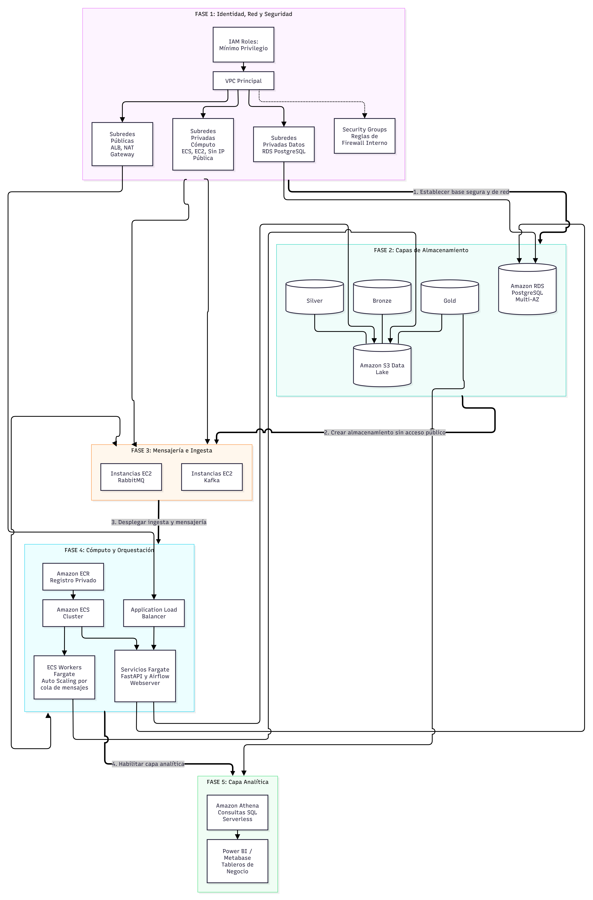

---
title: AWS Infrastructure
description: MercaAndes deployed AWS infrastructure in us-east-1 and its components.
sidebar_position: 3
---
# AWS Infrastructure

This page describes the AWS infrastructure that runs MercaAndes. The deployment targets the **us-east-1** region, AWS account `623588626787`, and covers connectivity, security, storage, messaging, compute, orchestration, and analytics.

## Infrastructure diagram

The diagram summarizes the platform layers and the main dependencies between them.



## Network and security

Amazon VPC provides the isolated network environment, distributed across public and private subnets:

- **Public subnets** host the internet-facing entry points: the Application Load Balancer and Fargate tasks with public IPs.
- **Private compute subnets** host internal services and workers: the batch node (Airflow and Spark) and the streaming node (Kafka, RabbitMQ, and Spark Streaming; private IP `10.0.11.155`).
- **Amazon RDS for PostgreSQL** runs in the database subnet group `mercaandes-rds-subnet-group`.
- An **Internet Gateway** provides connectivity for the public subnets; a **NAT Gateway**, when present, provides outbound internet access for private workloads that call external APIs.

The deployed Security Groups:

| Security group                   | Purpose                           | Inbound                           |
| -------------------------------- | --------------------------------- | --------------------------------- |
| `mercaandes-sg-alb-apis`       | APIs and load balancer traffic    | HTTP/Swagger on ports 80 and 8000 |
| `mercaandes-sg-rds`            | RDS PostgreSQL                    | Port 5432                         |
| `mercaandes-sg-batch-node`     | Batch node (Airflow + Spark)      | Internal application traffic      |
| `mercaandes-sg-streaming-node` | Streaming node (Kafka + RabbitMQ) | Internal application traffic      |

Port 5432 on `mercaandes-sg-rds` currently accepts connections independent of the source; restrict it to the batch, streaming, and API security groups to narrow the access surface to the three authorized workloads.

## Storage

### Amazon S3 data lake

The data lake bucket `mercaandes-data-lake-<account-name>` organizes the Medallion layers:

```text
s3://mercaandes-data-lake-<account-id>/
    bronze/          # Olist historical dataset (f1_kaggle), raw promotions, raw marketplace events
    silver/          # Cleaned and standardized data (customers, products, sales)
    gold/            # Business-rule outputs exported by the DAGs
        gold/{table}/{table}.csv   # Athena-partitioned folders
        gold/reprocessed/          # Reprocessed historical sales
```

Versioning is enabled on the bucket, and IAM policies scope access to the prefixes each workload needs.

### Amazon RDS for PostgreSQL

The serving layer runs on the RDS instance `mercaandes-postgres-gold`:

| Setting        | Value                                                          |
| -------------- | -------------------------------------------------------------- |
| Engine         | PostgreSQL 16.3                                                |
| Instance class | `db.t4g.micro`                                               |
| Storage        | 20 GB, gp3 (max allocated 100 GB in the Terraform declaration) |
| Database name  | `merca_pos`                                                  |
| Port           | 5432                                                           |
| Backups        | Automated, provisioned with a 1-day retention at deployment    |

The database contains the transactional POS schemas per country, the consolidated dimensional model, and the Silver/Gold view layer used by the dashboard. The schema organization is documented in the [Data Model](/docs/database/schemas-organization).

Terraform manages this configuration as Infrastructure as Code in `infrastructure_MercAndes/aws/terraform` (`rds.tf`, `variables.tf`): private placement, encrypted storage, deletion protection, backup window (03:00–04:00 UTC), maintenance window (Sun 04:30–05:30 UTC), and a 7-day backup retention. The Terraform identifier for the instance is `mercaandes-rds-gold-serving`.

### Administrative access

Administrators connect from a workstation through an EC2 bastion and an SSH tunnel to the private RDS endpoint. The connection profile uses region `us-east-1`, PostgreSQL port `5432`, and database `merca_pos`. The bastion Security Group accepts SSH (22) only from approved administrator sources, and the RDS Security Group accepts 5432 from the bastion. Keep the RDS hostname, bastion address, accounts, and credentials in a restricted operations runbook; this documentation site is publicly accessible, so it never lists them.

## Messaging and ingestion nodes

RabbitMQ and Kafka run on the streaming node, an EC2 instance placed in a private compute subnet (private IP `10.0.11.155`):

- **RabbitMQ** manages the operational queues (purchase notifications, weekly promotion ingestion, silent-store alerts). The management console runs on port 15672.
- **Apache Kafka** provides the persistent event stream of marketplace orders (topic `mercaandes.orders.events`, 3 partitions, 7-day retention). The Kafdrop console runs on port 9000.
- The **batch node** EC2 instance hosts Apache Airflow 3.1.5 and the Apache Spark 3.5 master/worker, polled by the Airflow workers through Celery.

Both nodes publish application logs to the CloudWatch log groups created under `/ecs/` for each service.

## Compute and containers

### Amazon ECR

Amazon ECR stores the private, versioned container images. The registry is `623588626787.dkr.ecr.us-east-1.amazonaws.com` and the repositories are:

| Repository                 | Image source (build context)                                            | Used by                    |
| -------------------------- | ----------------------------------------------------------------------- | -------------------------- |
| `api-orders`             | `Marketplace_Api`                                                     | Marketplace API            |
| `api-sellers`            | `Inventory_Api`                                                       | Inventory & Sellers API    |
| `api-promotions`         | `infrastructure_MercAndes/services/f7-weekly-promotions`              | Promotions API             |
| `seller-score-job`       | `MercaAndes_Spark_Gold_Transformations` (`Dockerfile.seller-score`) | Spark Gold job             |
| `seller-score-ingestion` | `infrastructure_MercAndes/services/seller-score-ingestion`            | Kafka consumer             |
| `api-exchange-rates`     | `api-exchange-rates`                                                  | Exchange-rate seed         |
| `api-holidays`           | `api-holidays`                                                        | Holiday seed               |
| `notification-worker`    | `infrastructure_MercAndes/services/notification-worker`               | Email notifications        |
| `operational-messaging`  | `infrastructure_MercAndes/services/operational-messaging`             | Reports and alerts         |
| `pos-database`           | `Transactional-POS-database`                                          | Migrations and POS seeding |
| `airflow`                | `infrastructure_MercAndes/airflow`                                    | Batch node                 |
| `spark`                  | `infrastructure_MercAndes/docker/spark`                               | Batch node                 |
| `kafka`                  | `infrastructure_MercAndes/docker/kafka`                               | Streaming node             |
| `rabbitmq`               | `infrastructure_MercAndes/docker/rabbitmq`                            | Streaming node             |

Images are tagged with `latest` plus the short commit SHA. The build-and-push workflow lives in `scripts/ecr-build-push.ps1` and is automated by GitHub Actions for the base images; the deployment log records how to authenticate against ECR and publish images per component.

### Amazon ECS, Fargate, and ALB

ECS cluster `mercaandes-ecs-cluster` runs the API services on Fargate tasks (1 vCPU/512 MB, one task per service, public IP enabled, `/health` on port 8000). Five task definitions are registered: `mercaandes-inventory-api`, `mercaandes-marketplace-api`, `mercaandes-promotions-api`, `batch-node`, and `streaming-node`. The Application Load Balancer lives in public subnets and routes traffic through `mercaandes-sg-alb-apis`. Task logs stream to `/ecs/<service-name>` in CloudWatch.

## Orchestration and analytics

Apache Airflow orchestrates the pipelines from the batch node; Apache Spark executes the transformations. AWS Glue Data Catalog registers the Gold datasets, and Amazon Athena queries them. Power BI consumes the serving views for the commercial dashboard, and Metabase is available for exploratory analysis.

## IAM roles

The IAM configuration is managed through Terraform and declared in `aws/terraform`. Six roles support the workloads:

| Role                                   | Purpose                                                                              |
| -------------------------------------- | ------------------------------------------------------------------------------------ |
| `mercaandes-api-ec2-role`            | API workloads (referenced by the ECS task role ARN).                                 |
| `mercaandes-batch-node-role`         | Batch node: Airflow and Spark, S3 read/write, RDS access.                            |
| `mercaandes-streaming-node-role`     | Streaming node: Kafka and RabbitMQ workloads, writing to the designated S3 prefixes. |
| `mercaandes-cicd-pipeline-role`      | GitHub CI/CD flows: ECR builds and ECS deployments.                                  |
| `mercaandes-ecs-task-execution-role` | Image pulls from ECR and CloudWatch log publication for ECS tasks.                   |
| `ecsTaskExecutionRole`               | Default AWS task-execution role retained alongside the custom role.                  |

Additional EKS configuration (`aws/terraform/eks.tf`) supports the Sellers API Kubernetes proof of concept; the production topology orchestrates APIs on ECS/Fargate.

## Related documentation

- [Architecture overview](01-overview.md)
- [Architecture components](02-components.md)
- [IAM and security](05-iam-security.md)
- [Deployed APIs and operational consoles](06-services-apis.md)
- [Data model](/docs/database/schemas-organization)
