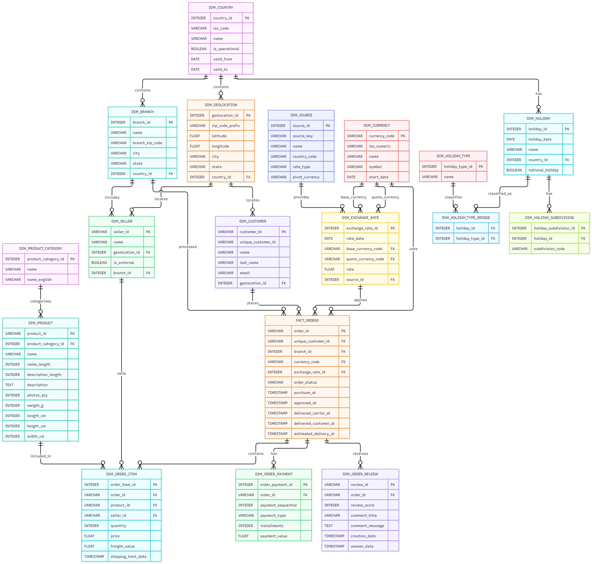

# Entity-Relationship Model

## 1. Overview

The MercaAndes Entity-Relationship Model (ERM) integrates historical Olist data with complementary information about countries, geolocation, branches, sellers, currencies, exchange rates, and holidays.

The model follows an evolutionary approach: new entities and relationships are introduced as additional data sources are integrated and new requirements are established.

## 2. Official ER Diagram

The following diagram represents the documented entity-relationship model.

The model separates geographic, corporate, commercial, and reference information into related entities.

## 3. Modeling Approach

### Snowflake Schema

The model adopts a Snowflake Schema, organizing information into normalized entities connected through primary and foreign keys.

This approach reduces redundancy, promotes referential integrity, and allows geographic and corporate information to be reused across multiple entities.

The documented model includes entities such as `Customer`, `Seller`, `Branch`, `Geolocation`, `Product`, `Product_Category`, and order-related fact entities.

The trade-off is that retrieving related information requires joins between tables.

## 4. Geographic and Corporate Domain

### Country

`Country` centralizes country information and distinguishes operational countries from countries retained for historical purposes.

Documented attributes include:

- `country_id`
- `iso_code`
- `name`
- `is_operational`
- `valid_from`
- `valid_to`

Brazil remains in the model because of the historical Olist dataset, even though it is not a current MercaAndes operational country.

### Geolocation

`Geolocation` stores reusable geographic information, including postal-code prefixes, coordinates, city, state, and country reference.

The same geographic location can be associated with multiple customers and sellers.

### Branch

`Branch` represents MercaAndes physical stores. It was introduced because the original Olist dataset does not provide an equivalent entity for MercaAndes branches.

A country can have multiple branches.

### Seller

A seller may be associated with a physical branch, but this relationship is optional because the marketplace also includes external sellers.

The model uses `branch_id` and `is_external` to represent these cases.

## 5. Order Domain

### Order and Order_Item

An order may contain multiple purchased products. Each product line has its own price, freight, quantity, seller, and other item-level information.

For this reason, `Order_Item` is modeled separately from `Order`.

### Seller and Order_Item

A marketplace order can contain products from different sellers. The seller relationship is therefore assigned to `Order_Item`, not directly to `Order`.

This creates an indirect many-to-many relationship between orders and sellers, resolved through order items.

### Product and Product_Category

`Product_Category` groups products into categories. Each product belongs to a category, while a category can contain multiple products.

### Order_Payment

`Order_Payment` is a separate entity because an order can contain multiple payment records.

### Order_Review

Reviews are optional. An order may have no review or one review, so the documented cardinality is `1:0..1`.

## 6. Currency and Exchange Rates

### Currency and Exchange_Rate

`Currency` stores currency information, while `Exchange_Rate` records exchange rates between a base currency and a quoted currency.

Separating these entities avoids repeating currency information across exchange-rate records.

### Source Traceability

Each exchange rate references a `Source`, allowing the origin of the rate to be identified.

### Exchange Rate Used by an Order

`Order` retains both `currency_code` and `exchange_rate_id`. This preserves the exchange rate associated with the order rather than relying exclusively on the rate currently available.

## 7. Holiday Domain

The holiday domain includes `Holiday`, `Holiday_Subdivision`, and `Holiday_Type`.

- A country can have multiple holidays.
- A holiday can apply to multiple subdivisions within a country.
- A holiday may have multiple types, such as Public and Bank.

The many-to-many relationship between holidays and types is resolved through `Holiday_Type_Bridge`.

The model also defines `holiday_type_id` as the identifier for `Holiday_Type`, avoiding confusion with `holiday_id`.

## 8. Main Relationship Cardinalities

| Relationship                   | Cardinality                               |
| ------------------------------ | ----------------------------------------- |
| Country → Geolocation         | 1:N                                       |
| Country → Branch              | 1:N                                       |
| Geolocation → Customer        | 1:N                                       |
| Geolocation → Seller          | 1:N                                       |
| Branch → Seller               | 1:N, optional branch for external sellers |
| Customer → Order              | 1:N                                       |
| Country → Order               | 1:N                                       |
| Product_Category → Product    | 1:N                                       |
| Order → Order_Item            | 1:N                                       |
| Product → Order_Item          | 1:N                                       |
| Seller → Order_Item           | 1:N                                       |
| Order ↔ Seller                | N:M, through Order_Item                   |
| Order → Order_Payment         | 1:N                                       |
| Order → Order_Review          | 1:0..1                                    |
| Currency → Order              | 1:N                                       |
| Currency → Exchange_Rate      | 1:N in each currency role                 |
| Source → Exchange_Rate        | 1:N                                       |
| Exchange_Rate → Order         | 1:N                                       |
| Country → Holiday             | 1:N                                       |
| Holiday → Holiday_Subdivision | 1:N                                       |
| Holiday ↔ Holiday_Type        | N:M, through Holiday_Type_Bridge          |

## 9. Related Documentation

- [Country Schemas](docs/03-database/01-entity-relationship-model.md)
