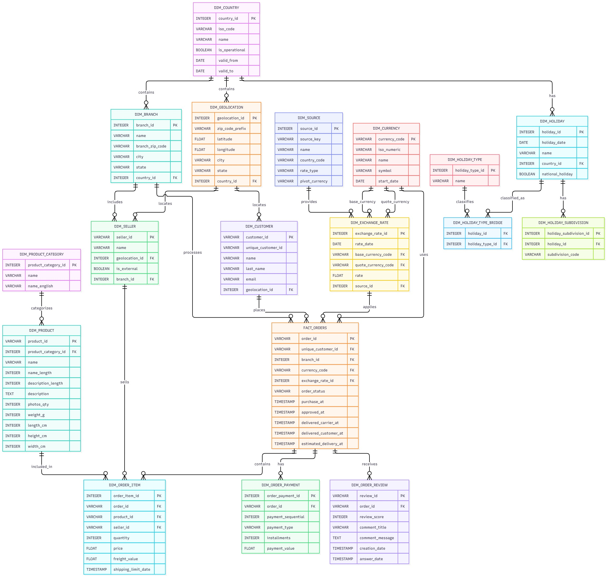

# Entity-Relationship Model

## 1. Overview

The MercaAndes Entity-Relationship Model (ERM) integrates the historical Olist data with complementary information about countries, geolocation, branches, sellers, currencies, exchange rates, and holidays.

The model follows an evolutionary approach: new entities and relationships were introduced as data sources were integrated and requirements were established.

The implementation layer uses the `dim_` prefix for dimensions and the `fact_` prefix for fact tables in the `public` schema of the serving database (PostgreSQL 16). The transactional repositories (Alembic migrations) and the consolidated serving DDL keep the same entity set.

## 2. Official ER Diagram

The following diagram represents the documented entity-relationship model.

The model separates geographic, corporate, commercial, and reference information into related entities.

## 3. Modeling Approach

### Snowflake Schema

The model adopts a Snowflake Schema, organizing information into normalized entities connected through primary and foreign keys.

This approach reduces redundancy, promotes referential integrity, and allows geographic and corporate information to be reused across multiple entities.

The implemented model includes the `dim_geolocation`, `dim_customer`, `dim_seller`, `dim_branch`, `dim_geolocation`, `dim_product`, `dim_product_category`, order and sale fact entities, and the reference dimensions for currencies, exchange rates, sources, countries, and holidays.

The trade-off is that retrieving related information requires joins between tables.

## 4. Geographic and Corporate Domain

### Country

`dim_country` centralizes country information and distinguishes operational countries from countries retained for historical purposes through `is_operational`.

Implemented attributes:

- `country_id` (UUID)
- `country_code` (ISO 2-letter code)
- `country_name`
- `currency_id` (reference to `dim_currency`)
- `is_operational`

Brazil remains in the model because of the historical Olist dataset, even though it is not a MercaAndes operational country.

### Geolocation

`dim_geolocation` stores reusable geographic information, including postal-code prefixes, coordinates, city, state, and the country reference.

The same geographic location can be associated with multiple customers and sellers (serving database).

### Branch

`dim_branch` represents MercaAndes physical stores. It was introduced because the original Olist dataset does not provide an equivalent entity for MercaAndes branches.

A country can have multiple branches; each branch belongs to a country referenced by `country_id`.

### Seller

`dim_seller` distinguishes marketplace sellers and store sellers through `external`. In the serving database a seller can reference a branch through `branch_id` (optional, used for store-owned sellers); the seeded demo data uses country/type groups, and `dim_seller_source_key` maps source-system identifiers to the canonical UUID.

## 5. Sales and Order Domain

### fact_sale and fact_sale_item

A sale may contain multiple purchased products; each product line has its own price, quantity, discount, and seller.

For this reason, `fact_sale_item` (`dim_product` reference) is modeled separately from `fact_sale`. `fact_sale` keeps a `net_amount` generated column (`gross_amount - discount_amount`), and each item keeps a computed `total_amount` (`quantity*unit_price - discount_amount`). The `status` column tracks the sale state (for example, `COMPLETED`, `RETURNED`, `REFUNDED`, `EXCEPTION_RETURN`), which feeds the returns audit.

### fact_order, fact_order_item, and marketplace events

Marketplace orders arrive as lifecycle events (`marketplace_events`, `marketplace_seller_score_events`) consumed through Kafka and the ingestion services. The consolidated model defines the `fact_order` and `fact_order_item` fact tables for the marketplace order domain.

The seller relationship is assigned at the line level, which creates an indirect many-to-many relationship between orders and sellers.

## 6. Currency and Exchange Rates

### dim_currency and dim_exchange_rate

`dim_currency` stores currency information, while `dim_exchange_rate` records exchange rates per currency, source, and date. A unique constraint `(currency_id, source_id, rate_date)` prevents duplicates.

### Source Traceability

Each exchange rate references a `dim_source` record, allowing the origin of the rate (for example, Frankfurter) to be identified.

### Exchange Rate Used by a Sale

Sale and order facts keep `currency_code` together with the transaction date, and the Gold views resolve the exchange rate to USD per date. When a date lacks a rate, `gold.vw_sales_consolidated` applies a documented fallback rate per currency (1.00 for USD; see the [Gold dictionary](05-gold-analytics-dictionary.md)).

## 7. Holiday Domain

The holiday domain includes `dim_holiday`, `dim_holiday_type`.

- A country can have multiple holidays.
- A holiday has a primary type (`dim_holiday_type_id`), avoiding confusion between `holiday_id` and the type identifier.

Nager.Date data for CO, PE, EC, BO, and CL seeds these tables. The Gold view `gold.vw_holiday_sales_impact` joins sales dates with the holiday calendar per country.

## 8. Main Relationship Cardinalities

| Relationship                       | Cardinality          |
| --------------------------------- | -------------------- |
| dim_currency → dim_country          | 1:N                  |
| dim_country → dim_geolocation       | 1:N                  |
| dim_country → dim_branch           | 1:N                  |
| dim_geolocation → dim_customer     | 1:N (optional)       |
| dim_geolocation → dim_branch       | 1:N (optional)       |
| dim_country → dim_seller           | 1:N                  |
| dim_branch → dim_seller            | 1:N, optional (serving database) |
| dim_customer → fact_sale           | 1:N (optional)       |
| dim_branch → fact_sale             | 1:N                  |
| dim_seller → fact_sale             | 1:N                  |
| fact_sale → fact_sale_item         | 1:N                  |
| dim_product → fact_sale_item       | 1:N                  |
| dim_product_category → dim_product | 1:N                  |
| dim_currency → dim_exchange_rate   | 1:N per source       |
| dim_source → dim_exchange_rate     | 1:N                  |
| dim_country → dim_holiday          | 1:N                  |
| dim_holiday_type → dim_holiday     | 1:N                  |

## 9. Related Documentation

- [Schemas and Database Organization](02-schemas-organization.md)
- [Dimensional Model](04-dimensional-model.md)
