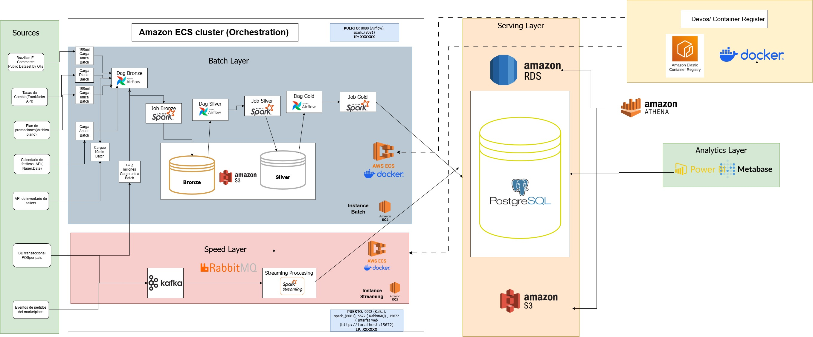

# Descripción general de la arquitectura

## 1. Descripción general

MercaAndes Omnicanal es una plataforma de datos que integra y procesa información de múltiples fuentes para soportar ventas, inventario y analítica del marketplace en los cinco países operativos.

La arquitectura combina la **Arquitectura Lambda** y la **Arquitectura Medallón**. Este enfoque separa el procesamiento histórico por lotes del procesamiento de flujos casi en tiempo real, organizando los datos según su nivel de transformación y calidad.

La infraestructura usa servicios de AWS y cargas de trabajo contenerizadas para soportar la ingesta, el procesamiento, la orquestación, el almacenamiento y la analítica en la región `us-east-1`.

## 2. Diagrama de arquitectura

El siguiente diagrama presenta la arquitectura de alto nivel, incluyendo fuentes de datos, capas de procesamiento, almacenamiento y consumo analítico.

La arquitectura separa responsabilidades de procesamiento mientras conecta la ingesta de datos, la transformación, el almacenamiento y la analítica.

## 3. Patrones arquitectónicos

### 3.1. Arquitectura Lambda

El enfoque Lambda divide el procesamiento de datos en dos capas lógicas.

**Capa de lotes (Batch)**

Procesa datos históricos mediante workflows programados. Apache Airflow orquesta los workflows (carga histórica, limpieza, reglas de negocio, seller scoring y promociones semanales), mientras que Apache Spark ejecuta las transformaciones por lotes vía JDBC y S3.

**Capa de velocidad (Speed)**

Procesa eventos entrantes para soportar visibilidad operativa casi en tiempo real. Apache Kafka transporta los eventos de pedidos del marketplace (tópic `mercaandes.orders.events`), RabbitMQ gestiona la mensajería operativa y las notificaciones, y Spark Streaming procesa el stream de pedidos en microlotes hacia la tabla `hot_inventory_risk`.

### 3.2. Arquitectura Medallón

El patrón Medallón organiza los datos en tres niveles de madurez dentro del lago de datos en Amazon S3.

| Capa   | Propósito                                                              |
| ------ | ---------------------------------------------------------------------- |
| Bronze | Conserva los datos originales de los sistemas fuente (dataset Olist, archivos de promociones, eventos crudos de marketplace). |
| Silver | Contiene datos limpiados, validados, estandarizados y depurados de duplicados. |
| Gold   | Contiene datos enriquecidos, modelados y agregados para el consumo del negocio. |

La capa de servicio reproduce la misma separación en PostgreSQL: el esquema `silver` contiene vistas curadas y anonimizadas, y el esquema `gold` contiene las vistas oficiales de Power BI. Los DAGs de procesamiento también trabajan con los esquemas de staging `z1_silver` y `z2_gold` durante sus ejecuciones.

## 4. Capas principales de la arquitectura

### 4.1. Fuentes de datos e ingesta

La plataforma recibe datos de datasets históricos, APIs externas y fuentes comerciales simuladas.

- Las ventas POS se siembran en la capa de servicio PostgreSQL y fluyen por los pipelines de tópicos por país.
- El dataset histórico de Olist se carga una vez (DAG `f1_kaggle_historical`).
- Las tasas de cambio provienen de la API Frankfurter y los festivos de la API Nager.Date.
- Los eventos de marketplace se generan mediante la Marketplace API y se publican en Kafka.
- Las promociones llegan como archivos Excel semanales procesados por el servicio F7.

### 4.2. Procesamiento y orquestación

- **Apache Airflow 3.1.5** define, programa y monitorea seis DAGs (incluido el DAG de reprocesamiento particionado).
- **Apache Spark 3.5** ejecuta las transformaciones por lotes (seller score, reglas de negocio) tanto en su cluster como en tareas JDBC de Airflow.
- **Apache Kafka** transporta pedidos en streaming con 3 particiones y 7 días de retención.
- **RabbitMQ** gestiona notificaciones, ingesta semanal de promociones, alertas y reportes asíncronos.
- **Spark Streaming** detecta quiebres inminentes en microlotes.

### 4.3. Almacenamiento y servicio

**Amazon S3** provee el lago de datos para las capas Bronze, Silver y Gold (bucket `mercaandes-data-lake-<account>`).

**Amazon RDS para PostgreSQL 16** provee la capa de servicio relacional: datos transaccionales POS por país, dimensiones y hechos compartidos, y las vistas analíticas Silver/Gold del tablero de negocio.

**Amazon Athena** permite consultas SQL sobre los datasets catalogados en el AWS Glue Data Catalog y almacenados en S3.

### 4.4. Analítica y consumo

- **Power BI** consume las vistas `gold` de la capa de servicio como fuente oficial del tablero comercial.
- **Metabase** se utiliza para la exploración de datos y consultas ad hoc.

## 5. Infraestructura y seguridad

La infraestructura corre en AWS en `us-east-1`:

- **Amazon VPC:** subredes públicas y privadas distribuidas entre zonas de disponibilidad.
- **Security Groups:** `mercaandes-sg-rds` (5432), `mercaandes-sg-alb-apis` (80, 8000) y los grupos de los nodos batch y streaming.
- **Roles IAM:** rol API EC2, nodo batch, nodo streaming, pipeline CI/CD y el rol de ejecución de tareas ECS.
- **Amazon ECR:** registro privado de imágenes (14 repositorios listados en el [catálogo de imágenes](aws-infrastructure)).
- **Amazon ECS con Fargate:** las APIs Inventory, Marketplace y Promotions (cluster `mercaandes-ecs-cluster`).
- **Amazon EC2:** aloja el nodo batch (Airflow + Spark) y el nodo streaming (Kafka + RabbitMQ).
- **Amazon RDS para PostgreSQL:** la base de datos de servicio Gold (`mercaandes-postgres-gold`).

Los detalles y los drivers de costo están descritos en [Infraestructura AWS y costos](aws-infrastructure).

## 6. Flujo general de datos

La plataforma sigue este flujo general:

1. Los datos se generan con simuladores o se obtienen de fuentes externas.
2. Los procesos de ingesta siembran la base de datos, cargan la capa S3 Bronze y publican eventos a Kafka y RabbitMQ.
3. Los workflows por lotes (Airflow + Spark) procesan los datos por las reglas Silver y Gold; los consumidores streaming mantienen las tablas de riesgo en caliente.
4. Amazon S3 almacena los datasets en las capas Bronze, Silver y Gold, particionados para Athena.
5. Amazon RDS para PostgreSQL sirve las vistas operativas y analíticas.
6. Power BI y Metabase consumen las vistas Gold para analítica y reportes.

## 7. Documentación relacionada

- [Componentes de la arquitectura](02-components.md)
- [Infraestructura AWS y costos](aws-infrastructure)
- [Decisiones técnicas](04-technical-decisions.md)

Para la configuración del entorno y las instrucciones de ejecución, consulta la sección de Instalación y despliegue.
