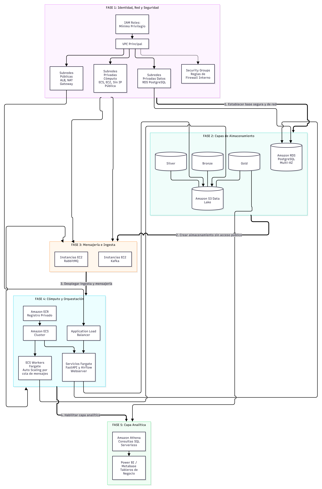

# Infraestructura y arquitectura de despliegue

> **Estado de la propuesta:** Aceptada
> **Fecha:** 9 de octubre de 2026
> **Proyecto:** MercaAndes

## Propósito y alcance

Esta página presenta el plan de infraestructura AWS aceptado para MercaAndes y explica cómo se relacionan sus fases, desde la red y la identidad hasta el consumo analítico. El diseño respalda las APIs, la ingesta y mensajería, el lago de datos, la base relacional de servicio y las herramientas de analítica.

La aceptación registra una decisión de arquitectura; por sí sola no demuestra que todos los recursos estén desplegados ni que cada validación haya pasado. El estado de despliegue se describe con el alcance de la evidencia disponible y debe actualizarse cuando se confirme la configuración vigente de AWS.

## Diagrama de infraestructura

El diagrama resume las cinco fases aceptadas y sus principales dependencias.

La secuencia sirve como guía de dependencias; no exige desplegar todos los recursos al mismo tiempo. Antes de exponer tráfico o datos de producción, valida cada fase y sus dependencias.

## Fase 1: Red, identidad y seguridad

### Identidad y permisos

Utiliza roles IAM distintos para la ejecución de servicios AWS y para las aplicaciones. El **rol de ejecución de tareas ECS** permite a ECS descargar imágenes de ECR y publicar logs de contenedores en CloudWatch. Los roles de las tareas reciben únicamente los permisos AWS que necesita cada carga, como acceso a prefijos específicos de S3.

El acceso a la base de datos se controla mediante su ubicación en la red privada, los Security Groups, las credenciales y la autorización propia de PostgreSQL. Un rol IAM por sí solo no concede acceso a PostgreSQL. Guarda las credenciales en un gestor de secretos aprobado y permite que cada carga consulte solo el secreto requerido.

Revisa las políticas de permisos y confianza de cada rol según el principio de privilegio mínimo. Evita permisos amplios como `s3:*` sin restricciones o acceso a todas las bases y recursos cuando sea posible delimitar el alcance.

### VPC y subredes

Ubica la plataforma en una VPC propia. Distribuye las subredes públicas y privadas entre al menos dos zonas de disponibilidad cuando el servicio elegido y su costo lo justifiquen.

- **Subredes públicas:** alojan puntos de entrada a internet, como el Application Load Balancer. Un Internet Gateway proporciona su ruta a internet.
- **Subredes privadas de cómputo:** alojan servicios internos y workers, incluidas tareas ECS y cargas privadas en EC2 para mensajería cuando aplique.
- **Subredes privadas de datos:** alojan Amazon RDS para PostgreSQL.
- Un **NAT Gateway** puede proporcionar salida a internet a cargas privadas que necesiten consultar APIs externas o descargar actualizaciones. Incluye sus costos por hora y procesamiento de datos en la estimación.

Mantén las bases de datos y los brokers internos fuera de subredes públicas. Concede a las cargas privadas únicamente las rutas y la conectividad de salida que necesiten.

### Security Groups

Los Security Groups son firewalls con estado asociados a los recursos. Los límites de tráfico previstos son:

| Grupo | Tráfico de entrada previsto |
|---|---|
| `SG_ALB` | HTTP/HTTPS desde clientes de internet aprobados; utiliza HTTPS para el acceso público siempre que esté configurado. |
| `SG_ECS` | Tráfico de aplicación solo desde `SG_ALB` en servicios expuestos por el balanceador. Agrega reglas acotadas para la comunicación interna necesaria. |
| `SG_RDS` | PostgreSQL por el puerto 5432 solo desde los Security Groups específicos de las aplicaciones o workers que necesiten la base de datos. |

No abras el puerto 5432 a `0.0.0.0/0`. Confirma que RDS no sea público y que un cliente de internet no pueda conectarse directamente. Para una prueba autorizada, usa una carga o un host de prueba controlado dentro de la VPC con una regla acotada; elimina cualquier acceso temporal al terminar.

## Fase 2: Capas de almacenamiento

### Lago de datos en Amazon S3

Almacena los datos en las capas Bronze, Silver y Gold. Pueden ser buckets separados o prefijos de un mismo bucket, siempre que las políticas conserven el aislamiento necesario. Bloquea el acceso público, habilita cifrado y limita los permisos IAM a los prefijos que necesite cada carga.

Valida la ruta de escritura con un objeto de prueba inocuo en Bronze, comprueba que el rol correspondiente pueda leerlo o escribirlo y elimina el objeto al finalizar. Una carga exitosa confirma el acceso a esa ruta; no valida por sí sola el flujo de ingesta ni las transformaciones.

### Amazon RDS para PostgreSQL

Ubica RDS PostgreSQL en las subredes privadas de datos y asígnale `SG_RDS`. Documenta la versión del motor, tipo de instancia, almacenamiento, retención de respaldos, cifrado, ventana de mantenimiento y uso de Multi-AZ. Estos parámetros afectan la resiliencia y el costo.

El diagrama aceptado representa PostgreSQL en modo Multi-AZ. Confirma que corresponda a la configuración desplegada y registra el balance entre disponibilidad y costo; el diagrama por sí solo no demuestra que Multi-AZ esté habilitado.

Comprueba la conectividad desde una aplicación autorizada o una carga de prueba dentro de la VPC, usando credenciales gestionadas como secreto y TLS cuando esté configurado. No hagas pública la base ni abras el puerto 5432 para probarla desde un computador personal. Confirma que los respaldos y la restauración satisfagan las necesidades de recuperación.

### Acceso administrativo mediante túnel SSH

Para que una persona autorizada se conecte desde su equipo, el perfil recibido describe una ruta que pasa por una instancia EC2 bastion y un túnel SSH hasta el endpoint privado de RDS. Indica la región AWS `us-east-2`, el puerto PostgreSQL `5432` y la base `merca_gold`. Guarda el hostname exacto de RDS, la dirección del bastion, los nombres de cuenta y las credenciales en un medio operativo con acceso restringido; este sitio de documentación podría ser público.

En la configuración SSH del cliente de base de datos, utiliza el bastion como host del túnel y el endpoint RDS como host de base de datos. El Security Group de RDS debe permitir el puerto 5432 desde el Security Group del bastion. El Security Group del bastion debe permitir el puerto 22 solo desde los orígenes administrativos aprobados. No abras ninguno de esos puertos a todas las direcciones de internet.

Antes de considerar el perfil como la conexión vigente de producción, concilia la región y el nombre de instancia: el perfil apunta a `us-east-2`, mientras que el valor por defecto de Terraform en el repositorio es `us-east-1`, y el identificador RDS de Terraform no coincide con el nombre del endpoint recibido. El nombre de base y el nombre de cuenta sí coinciden con los valores por defecto de Terraform; aun así, confirma todos los valores con la instancia RDS activa y el gestor de secretos aprobado.

En Amazon Linux 2 y Amazon Linux 2023, la autenticación SSH con contraseña está deshabilitada por defecto; normalmente `ec2-user` se conecta con el par de claves de EC2 u otro método autorizado basado en claves. No asumas que una contraseña en el formulario SSH del cliente es válida. Confirma con la persona administradora la AMI y la política de autenticación del bastion. Usa una credencial de base de datos y una clave SSH distintas; rota las credenciales que se hayan compartido por chat o en código fuente.

## Fase 3: Mensajería e ingesta

RabbitMQ y Kafka cubren necesidades distintas: RabbitMQ gestiona colas operativas y tareas asíncronas; Kafka mantiene un flujo durable de eventos de marketplace para sus consumidores. El diseño aceptado ubica los brokers en instancias EC2 dentro de subredes privadas de cómputo.

Antes de depender de los brokers para eventos de producción, define persistencia, confirmaciones, reintentos y colas de mensajes fallidos, así como topics y retención en Kafka. Los brokers con estado necesitan un diseño de clúster y almacenamiento que preserve la identidad y los datos de cada nodo. No agregues un Auto Scaling Group genérico a los brokers sin diseñar la membresía del clúster, el almacenamiento persistente y el procedimiento de recuperación.

Valida la conectividad desde otra carga autorizada dentro de la misma VPC. Para RabbitMQ, comprueba que la aplicación pueda conectarse al puerto configurado (habitualmente 5672) sin exponer el broker a internet. Después publica y consume un mensaje de prueba y confirma las respuestas de recepción y la recuperación.

## Fase 4: Contenedores y orquestación

### Registro de imágenes ECR

Publica en Amazon ECR imágenes privadas y versionadas para APIs, workers y trabajos de procesamiento. Etiqueta las imágenes de producción con un identificador inmutable del commit o la versión; puedes conservar `latest` como referencia auxiliar, pero no lo uses como única identificación del despliegue.

Antes de actualizar una definición de tarea ECS, comprueba en ECR el repositorio y el tag o digest correspondiente.

### ECS, Fargate y Application Load Balancer

Amazon ECS administra las definiciones de tareas y los despliegues. Ejecuta en Fargate las APIs compatibles y ubica el Application Load Balancer en las subredes públicas. Configura grupos de destino y health checks para que el balanceador envíe tráfico solo a tareas saludables. En los servicios que deben pasar por el balanceador, permite entrada a las tareas únicamente desde el Security Group del ALB.

### Workers asíncronos y escalamiento

Ejecuta los workers como servicios o tareas ECS en subredes privadas de cómputo. Concede a cada worker solo el acceso a broker, base de datos, secreto y S3 que requiera su proceso. Prueba la publicación, el consumo y la confirmación de mensajes, además de los logs de CloudWatch.

El escalamiento de workers basado en la profundidad de la cola requiere publicar una métrica de profundidad en CloudWatch y asociarla a una política de escalamiento ECS. Regístralo como implementado solo después de verificar la métrica, la política y el comportamiento de escalamiento y reducción.

## Fase 5: Capa analítica

Registra los conjuntos Gold en el catálogo de datos de AWS Glue y consúltalos mediante Amazon Athena. Configura por separado la ubicación de resultados de Athena y los permisos sobre los datos de origen. Usa una consulta pequeña de solo lectura, por ejemplo una muestra limitada de una tabla Gold, para verificar el catálogo, los permisos S3 y la ruta de consulta.

Power BI o Metabase pueden consumir datos curados mediante la conexión de servicio aprobada. Documenta el método de conexión y las credenciales aparte; no incluyas secretos en tableros, código ni en esta página.

## Registro de despliegue y estado de verificación

La bitácora de despliegue registra una conexión exitosa a PostgreSQL y endpoints de API que responden. También deja pendientes de verificar el bucket y los prefijos S3; no registra una consulta de Athena exitosa. Las APIs se describen con IP pública de tarea y puerto 8000, distinto del límite aceptado de ALB público hacia tareas privadas indicado arriba.

Antes de declarar verificada toda la plataforma, concilia estas diferencias con la configuración activa de AWS. Confirma directamente S3 y Athena, verifica si las APIs están detrás del ALB y registra cualquier excepción deliberada al diseño de subredes privadas y Security Groups. Limita los endpoints públicos a las APIs que deban serlo; nunca expongas RDS ni los puertos de los brokers.

## Resumen de fases

| Fase | Resultado principal | Evidencia que conviene registrar |
|---|---|---|
| 1. Red y seguridad | Roles IAM, VPC, rutas de subred y Security Groups controlan el acceso. | Políticas y relaciones de confianza, inventario de subredes y rutas, reglas de Security Groups y una comprobación fallida de acceso público a la base. |
| 2. Almacenamiento | El lago S3 y PostgreSQL privado están disponibles para cargas autorizadas. | Prueba de objeto S3, subred y acceso público de RDS, respaldos y prueba autorizada de conectividad. |
| 3. Mensajería e ingesta | RabbitMQ y Kafka reciben y entregan eventos dentro de la VPC. | Salud de brokers, flujo de mensaje de prueba, confirmaciones, persistencia y recuperación. |
| 4. Cómputo y orquestación | Imágenes ECR se ejecutan como servicios y workers ECS/Fargate saludables. | Digest de imagen, revisión de definición de tarea, salud del ALB, logs de CloudWatch y evidencia de procesamiento. |
| 5. Analítica | Athena consulta datos Gold registrados para los consumidores analíticos. | Definición de catálogo, ubicación de resultados, consulta limitada exitosa y conexión BI validada. |

## Documentación relacionada

- [Visión general de la arquitectura](01-overview.md)
- [Componentes de arquitectura](02-components.md)
- [Decisiones técnicas](04-technical-decisions.md)
- [IAM y seguridad](05-iam-security.md)
