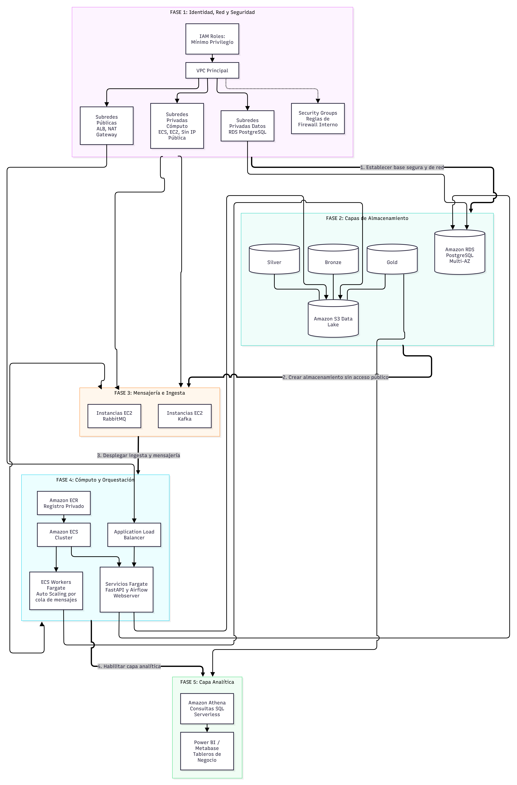

# Infraestructura AWS

Esta página describe la infraestructura AWS que ejecuta MercaAndes. El despliegue se ejecuta en la región **us-east-1**, la cuenta AWS `623588626787`, y cubre conectividad, seguridad, almacenamiento, mensajería, cómputo, orquestación y analítica.

## Diagrama de infraestructura

El diagrama resume las capas de la plataforma y las dependencias principales entre ellas.



## Red y seguridad

Amazon VPC provee el entorno de red aislado, distribuido en subredes públicas y privadas:

- Las **subredes públicas** alojan los puntos de entrada expuestos a internet: el Application Load Balancer y las tareas Fargate con IP pública.
- Las **subredes privadas de cómputo** alojan servicios internos y workers: el nodo batch (Airflow y Spark) y el nodo streaming (Kafka, RabbitMQ y Spark Streaming; IP privada `10.0.11.155`).
- **Amazon RDS para PostgreSQL** corre en el DB subnet group `mercaandes-rds-subnet-group`.
- Un **Internet Gateway** provee conectividad a las subredes públicas; un **NAT Gateway**, cuando está presente, provee salida a internet a las cargas privadas que consultan APIs externas.

Los Security Groups desplegados:

| Security group | Propósito | Inbound |
|---|---|---|
| `mercaandes-sg-alb-apis` | Tráfico de APIs y balanceador | HTTP/Swagger en puertos 80 y 8000 |
| `mercaandes-sg-rds` | RDS PostgreSQL | Puerto 5432 |
| `mercaandes-sg-batch-node` | Nodo batch (Airflow + Spark) | Tráfico interno de aplicación |
| `mercaandes-sg-streaming-node` | Nodo streaming (Kafka + RabbitMQ) | Tráfico interno de aplicación |

El puerto 5432 en `mercaandes-sg-rds` actualmente acepta conexiones independientes de la fuente; restríngelo a los security groups de batch, streaming y APIs para acotar la superficie de acceso a las tres cargas autorizadas.

## Almacenamiento

### Lago de datos en Amazon S3

El bucket del lago `mercaandes-data-lake-<account-id>` organiza las capas Medallón:

```text
s3://mercaandes-data-lake-<account-id>/
    bronze/          # Histórico Olist (f1_kaggle), promociones crudas, eventos crudos de marketplace
    silver/          # Datos limpiados y estandarizados (clientes, productos, ventas)
    gold/            # Salidas de reglas de negocio exportadas por los DAGs
        gold/{table}/{table}.csv   # Carpetas particionadas para Athena
        gold/reprocessed/          # Ventas históricas reprocesadas
```

El versioning está habilitado en el bucket, y las políticas IAM acotan el acceso a los prefijos que cada workload necesita.

### Amazon RDS para PostgreSQL

La capa de servicio corre en la instancia RDS `mercaandes-postgres-gold`:

| Configuración | Valor |
|---|---|
| Motor | PostgreSQL 16.3 |
| Clase de instancia | `db.t4g.micro` |
| Almacenamiento | 20 GB, gp3 (máximo asignable 100 GB en la declaración Terraform) |
| Nombre de base de datos | `merca_pos` |
| Puerto | 5432 |
| Backups | Automáticos, aprovisionados con retención de 1 día en el despliegue |

La base de datos contiene los esquemas transaccionales POS por país, el modelo dimensional consolidado y la capa Silver/Gold de vistas que alimenta el tablero. La organización de esquemas está documentada en el [Modelo de datos](/docs/database/schemas-organization).

Terraform gestiona esta configuración como Infraestructura como Código en `infrastructure_MercAndes/aws/terraform` (`rds.tf`, `variables.tf`): ubicación privada, almacenamiento cifrado, protección de borrado, ventana de backup (03:00–04:00 UTC), ventana de mantenimiento (dom 04:30–05:30 UTC) y retención de backups de 7 días. El identificador Terraform de la instancia es `mercaandes-rds-gold-serving`.

### Acceso administrativo

Los administradores se conectan desde una estación de trabajo a través de un bastión EC2 y un túnel SSH hacia el endpoint privado de RDS. El perfil de conexión usa región `us-east-1`, puerto PostgreSQL `5432` y base de datos `merca_pos`. El Security Group del bastión acepta SSH (22) solo de fuentes de administrador aprobadas, y el Security Group de RDS acepta 5432 desde el bastión. Mantén el hostname de RDS, la dirección del bastión, las cuentas y las credenciales en un runbook de operaciones restringido; este sitio de documentación es de acceso público y nunca los lista.

## Nodos de mensajería e ingesta

RabbitMQ y Kafka corren en el nodo streaming, una instancia EC2 en una subred privada de cómputo (IP privada `10.0.11.155`):

- **RabbitMQ** gestiona las colas operativas (notificaciones de compra, ingesta semanal de promociones, alertas de tiendas silenciosas). La consola de administración corre en el puerto 15672.
- **Apache Kafka** provee el stream persistente de eventos de pedidos del marketplace (tópic `mercaandes.orders.events`, 3 particiones, retención de 7 días). La consola Kafdrop corre en el puerto 9000.
- La instancia **nodo batch** EC2 aloja Apache Airflow 3.1.5 y el master/worker de Apache Spark 3.5, cuya capacidad usa la ejecución Celery de Airflow.

Ambos nodos publican logs de aplicación en los log groups de CloudWatch creados bajo `/ecs/` para cada servicio.

## Cómputo y contenedores

### Amazon ECR

Amazon ECR almacena las imágenes privadas versionadas. El registro es `623588626787.dkr.ecr.us-east-1.amazonaws.com` y los repositorios son:

| Repositorio | Contexto de build | Usado por |
|---|---|---|
| `api-orders` | `Marketplace_Api` | Marketplace API |
| `api-sellers` | `Inventory_Api` | Inventory & Sellers API |
| `api-promotions` | `infrastructure_MercAndes/services/f7-weekly-promotions` | Promotions API |
| `seller-score-job` | `MercaAndes_Spark_Gold_Transformations` (`Dockerfile.seller-score`) | Job Spark Gold |
| `seller-score-ingestion` | `infrastructure_MercAndes/services/seller-score-ingestion` | Consumidor Kafka |
| `api-exchange-rates` | `api-exchange-rates` | Semilla de divisas |
| `api-holidays` | `api-holidays` | Semilla de festivos |
| `notification-worker` | `infrastructure_MercAndes/services/notification-worker` | Notificaciones por correo |
| `operational-messaging` | `infrastructure_MercAndes/services/operational-messaging` | Reportes y alertas |
| `pos-database` | `Transactional-POS-database` | Migraciones y semillas POS |
| `airflow` | `infrastructure_MercAndes/airflow` | Nodo batch |
| `spark` | `infrastructure_MercAndes/docker/spark` | Nodo batch |
| `kafka` | `infrastructure_MercAndes/docker/kafka` | Nodo streaming |
| `rabbitmq` | `infrastructure_MercAndes/docker/rabbitmq` | Nodo streaming |

Las imágenes se etiquetan con `latest` más el SHA corto del commit. El flujo de build y push vive en `scripts/ecr-build-push.ps1` y lo automatiza GitHub Actions para las imágenes base; la bitácora de despliegue documenta cómo autenticarse contra ECR y publicar imágenes por componente.

### Amazon ECS, Fargate y ALB

El cluster ECS `mercaandes-ecs-cluster` ejecuta los servicios de API en tareas Fargate (1 vCPU/512 MB, una tarea por servicio, IP pública habilitada, `/health` en el puerto 8000). Hay cinco task definitions registradas: `mercaandes-inventory-api`, `mercaandes-marketplace-api`, `mercaandes-promotions-api`, `batch-node` y `streaming-node`. El Application Load Balancer vive en las subredes públicas y enruta el tráfico por el security group `mercaandes-sg-alb-apis`. Los logs de tarea llegan a `/ecs/<service-name>` en CloudWatch.

## Orquestación y analítica

Apache Airflow orquesta los pipelines desde el nodo batch; Apache Spark ejecuta las transformaciones. El AWS Glue Data Catalog registra los datasets Gold, y Amazon Athena los consulta. Power BI consume las vistas de servicio para el tablero comercial y Metabase está disponible para análisis exploratorio.

## Roles IAM

La configuración IAM se gestiona vía Terraform y está declarada en `aws/terraform`. Seis roles soportan los workloads:

| Rol | Propósito |
|---|---|
| `mercaandes-api-ec2-role` | Cargas API (referenciado como task role en las definiciones ECS). |
| `mercaandes-batch-node-role` | Nodo batch: Airflow y Spark, lectura/escritura S3, acceso RDS. |
| `mercaandes-streaming-node-role` | Nodo streaming: workloads Kafka y RabbitMQ, escritura en los prefijos S3 designados. |
| `mercaandes-cicd-pipeline-role` | Flujos CI/CD de GitHub: builds ECR y despliegues ECS. |
| `mercaandes-ecs-task-execution-role` | Pull de imágenes ECR y publicación de logs a CloudWatch para las tareas ECS. |
| `ecsTaskExecutionRole` | Rol de ejecución de tareas por defecto de AWS conservado junto al rol custom. |

La configuración EKS adicional (`aws/terraform/eks.tf`) soporta la prueba de concepto Kubernetes de la Sellers API; la topología productiva orquesta las APIs en ECS/Fargate.

## Documentación relacionada

- [Descripción general de la arquitectura](01-overview.md)
- [Componentes de la arquitectura](02-components.md)
- [IAM y seguridad](05-iam-security.md)
- [APIs desplegadas y consolas operativas](06-services-apis.md)
- [Modelo de datos](/docs/database/schemas-organization)
