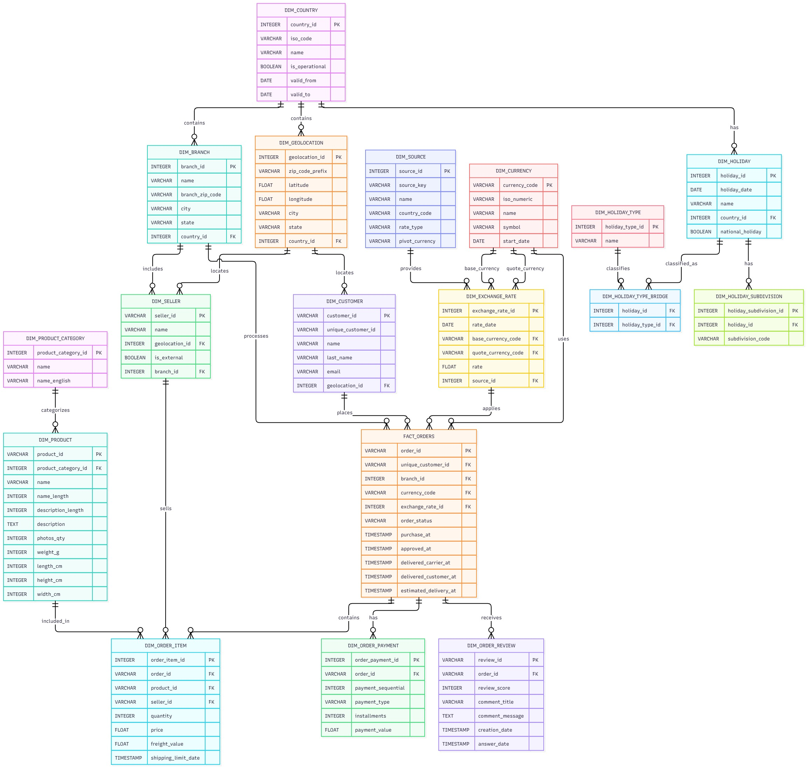

# Modelo entidad-relación

## 1. Resumen

El modelo entidad-relación de MercaAndes integra el histórico de Olist con información complementaria de países, geolocalización, sucursales, vendedores, monedas, tasas de cambio y festivos.

El modelo evoluciona a medida que se integran nuevas fuentes y se establecen requisitos. Por ello, distingue el modelo amplio documentado de los esquemas y tablas que estén implementados en cada base de datos.

## 2. Diagrama oficial

El siguiente diagrama representa el modelo entidad-relación documentado.

El modelo organiza la información geográfica, corporativa, comercial y de referencia en entidades relacionadas.

## 3. Enfoque de modelado

### Esquema copo de nieve

El modelo adopta un esquema copo de nieve: las entidades normalizadas se conectan mediante claves primarias y foráneas. Este enfoque reduce redundancia, mantiene integridad referencial y permite reutilizar información geográfica y corporativa.

El modelo incluye entidades como `Customer`, `Seller`, `Branch`, `Geolocation`, `Product`, `Product_Category` y entidades asociadas a pedidos. La consulta de información relacionada requiere combinar las tablas mediante joins.

## 4. Dominio geográfico y corporativo

### País

`Country` centraliza los países y distingue los países operativos de los incluidos por razones históricas. Los atributos documentados son `country_id`, `iso_code`, `name`, `is_operational`, `valid_from` y `valid_to`.

Brasil permanece en el modelo por el conjunto histórico de Olist, aunque no sea uno de los países actuales de operación POS de MercaAndes.

### Geolocalización

`Geolocation` conserva prefijos postales, coordenadas, ciudad, estado y referencia al país. Una misma ubicación puede vincularse a varios clientes y vendedores.

### Sucursal

`Branch` representa las tiendas físicas de MercaAndes, entidad que no existe como tal en el conjunto original de Olist. Un país puede tener varias sucursales.

### Vendedor

Un vendedor puede vincularse a una sucursal física; el vínculo es opcional porque el marketplace también contempla vendedores externos. `branch_id` e `is_external` representan estos casos.

## 5. Dominio de pedidos

### Pedido y artículo del pedido

Un pedido puede incluir varios productos. Cada línea tiene su propio precio, flete, cantidad, vendedor y demás atributos de artículo; por eso `Order_Item` se modela por separado de `Order`.

### Vendedor y artículo del pedido

Un pedido de marketplace puede incluir productos de varios vendedores. La relación con el vendedor se asigna a `Order_Item` y no directamente a `Order`. Así, la relación entre pedidos y vendedores es muchos a muchos y se resuelve mediante los artículos.

### Producto y categoría

`Product_Category` agrupa los productos. Cada producto pertenece a una categoría y una categoría puede contener varios productos.

### Pagos y reseñas

`Order_Payment` es una entidad separada porque un pedido puede tener varios registros de pago. Las reseñas son opcionales: un pedido puede no tener ninguna o tener una, con cardinalidad documentada `1:0..1`.

## 6. Monedas y tasas de cambio

`Currency` almacena información de monedas y `Exchange_Rate` registra las tasas entre una moneda base y otra cotizada. La separación evita repetir la información de moneda en cada tasa.

Cada tasa de cambio referencia `Source`, lo que permite identificar su origen. `Order` conserva `currency_code` y `exchange_rate_id` para retener la tasa asociada al pedido y no depender únicamente de la tasa vigente.

## 7. Dominio de festivos

El dominio de festivos contiene `Holiday`, `Holiday_Subdivision` y `Holiday_Type`:

- Un país puede tener varios festivos.
- Un festivo puede aplicar a varias subdivisiones del país.
- Un festivo puede tener varios tipos, como `Public` y `Bank`.
- La relación muchos a muchos entre festivos y tipos se resuelve mediante `Holiday_Type_Bridge`.

El modelo define `holiday_type_id` como identificador de `Holiday_Type`, para evitar confundirlo con `holiday_id`.

## 8. Cardinalidades principales

| Relación | Cardinalidad |
|---|---|
| Country → Geolocation | 1:N |
| Country → Branch | 1:N |
| Geolocation → Customer | 1:N |
| Geolocation → Seller | 1:N |
| Branch → Seller | 1:N; sucursal opcional para vendedores externos |
| Customer → Order | 1:N |
| Country → Order | 1:N |
| Product_Category → Product | 1:N |
| Order → Order_Item | 1:N |
| Product → Order_Item | 1:N |
| Seller → Order_Item | 1:N |
| Order ↔ Seller | N:M, mediante Order_Item |
| Order → Order_Payment | 1:N |
| Order → Order_Review | 1:0..1 |
| Currency → Order | 1:N |
| Currency → Exchange_Rate | 1:N en cada rol de moneda |
| Source → Exchange_Rate | 1:N |
| Exchange_Rate → Order | 1:N |
| Country → Holiday | 1:N |
| Holiday → Holiday_Subdivision | 1:N |
| Holiday ↔ Holiday_Type | N:M, mediante Holiday_Type_Bridge |

## 9. Documentación relacionada

- [Esquemas por país](02-country-schemas.md)
